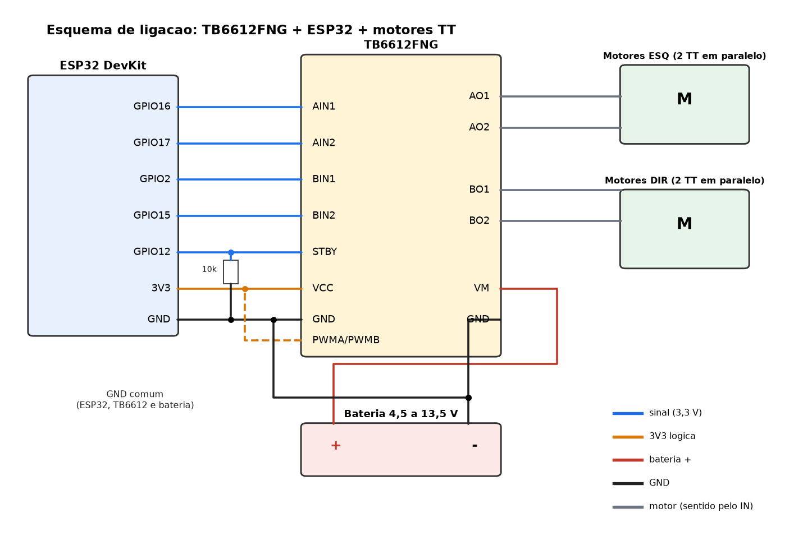
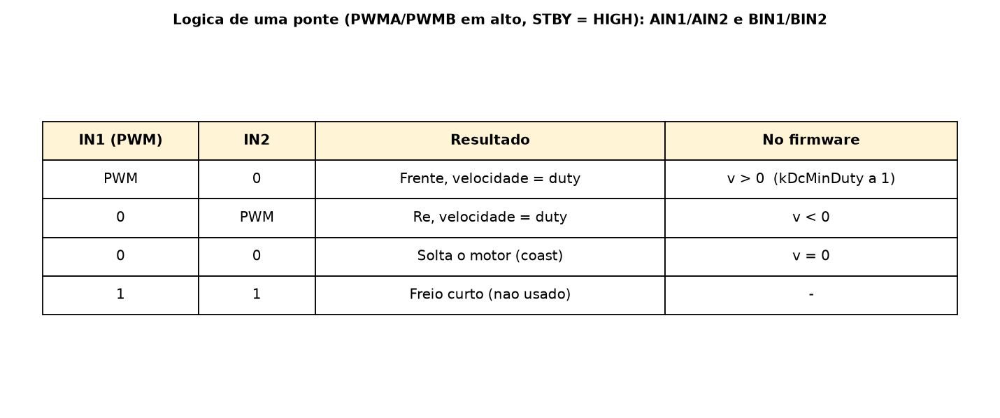

# TB6612FNG no carrinho amarelo (motores TT) — 2026-10-22

Firmware: ambiente `bringup_dc` / `follow_dc` (`firmware/`). Pinos em `firmware/include/pins.h`, sinais em `firmware/include/params.h`. Compila; nao testado em hardware.

## Ligacao


| TB6612 | Liga em | Observacao |
|---|---|---|
| VM | bateria + (4,5 a 13,5 V) | alimenta os motores |
| VCC | 3V3 do ESP32 | logica |
| GND (qualquer) | GND comum ESP32 + bateria | obrigatorio |
| AIN1 / AIN2 | GPIO 16 / 17 | motor esquerdo (`kMotorLA/LB`) |
| BIN1 / BIN2 | GPIO 2 / 15 | motor direito (`kMotorRA/RB`) |
| PWMA, PWMB | 3V3 | fixos em alto; o PWM sai pelos pinos IN |
| STBY | GPIO 12 + resistor 10 kOhm para GND | o chip so acorda depois do `begin()` |
| AO1/AO2 | motores do lado esquerdo | 2 motores em paralelo |
| BO1/BO2 | motores do lado direito | idem |

## Uso
1. Sentido invertido (anda de re ou gira para o lado errado): inverter `kLeftSign` / `kRightSign` em `params.h`.
2. Corrente: 1,2 A continuos por canal (3,2 A de pico). 2 motores TT em paralelo no mesmo canal ficam no limite (cada um puxa 0,5 a 0,8 A ao travar); se esquentar, um motor por canal.
3. PWM nos pinos IN com PWMA/PWMB em alto = ponte H de 2 entradas, igual ao `DcDrive`: PWM em A = frente, PWM em B = re, os dois baixos = solta o motor.
4. GPIO 2 e 15 sao pinos de boot do ESP32 e podem dar um tranco curto; o STBY baixo no boot evita.
5. Nao alimentar o ESP32 pelo VM sem regulador (regulador 5 V ou USB). O MG996R do ombro tem fonte propria, GND comum.



## Teste (rodas no ar)
```
cd firmware && pio run -e bringup_dc -t upload && pio device monitor
```
Conferir o sentido de cada lado; medir `kDcMinDuty` (duty em que o TT comeca a girar) e a velocidade a 100% (`kDcFullSpeedMmS`): os dois valores em `params.h` ainda sao chutes.
