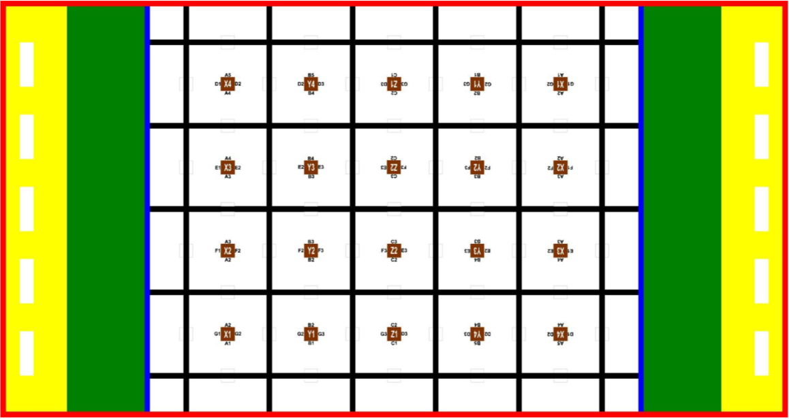

# Seguidor que ve o mapa e pega o bloco mais proximo (plano, 2026-10-28)

Status: PLANO, nada executado alem do `core/map.h` (grafo + busca, com testes no PC). Origem: codigo do colega (ESP32-S3 + TB6612 + barra RC + TCS34725 do chao) colado na conversa, mais `docs/`, `sim/` e o PDF das regras.

## Objetivo
O robo segue a linha preta. Em cada cruzamento (os 8 sensores no preto) ele para, olha as opcoes (ruas saindo dele), escolhe a mais proxima que leva a um bloco e vira para la. Ao chegar no bloco, pega. Entrega fica fora desta fase.

Mapa inteiro da arena (imagem do usuario): 6 linhas pretas verticais e 5 horizontais, ou seja, os 6 x 5 cruzamentos do grafo; azul = limite entre a area livre e a cidade, vermelho = borda; marcas marrons X/Y/Z no centro de cada quadrado (cubos ali nao podem ser pegos); quadradinhos cinza claros = lugares possiveis de cubo sobre as ruas.

## O que as regras permitem assumir
- A rede de ruas e fixa: 6 x 5 cruzamentos, celulas de ~300 mm, rua de 20 mm (`sim/arena.py`; geometria estimada da Figura 1, **conferir com a arena real**).
- A posicao dos cubos **nao e fixa**: o arbitro define antes da partida. Entao o mapa e conhecido e a **ocupacao e descoberta andando**.
- Cubos de 50 mm. **So os que ficam nas ruas (arestas do grafo) contam**: nao ha cubo pegavel em cruzamento, e os cubos no centro dos quadrados (marcas marrons, entre as linhas pretas) **nao podem ser pegos** (decisao do usuario, 2026-10-28). Por isso o mapa so tem arestas.

## Hardware desta entrega (ESP32-S3 do colega)
| Peca | Pinos / estado |
|---|---|
| Barra RC, 8 sensores | 8,7,6,5,4,3,2,1 (S1 = esquerda) |
| TB6612 | AIN1 **12**, AIN2 **11**, PWMA 13, BIN1 14, BIN2 21, PWMB 47, STBY 38 |
| TCS34725 do chao | SDA 15, SCL 16, addr 0x29 |
| LED RGB | 48 |
| Ultrassom frontal | **pinos a definir** |
| Sensor de cor frontal | **pinos a definir** (mesmo addr 0x29 do chao: precisa de outro barramento I2C) |
| Garra | **pino a definir** |
| MPU (giroscopio) | **ainda NAO instalado; nada depende dele por enquanto** (`TurnSpec.useGyro = false`); o repo ja tem `hal::Imu` (MPU6050, addr 0x68, `Wire`). Pode dividir o barramento com o TCS34725 do chao (0x29). Pinos a confirmar |
| Motores | **4 motores amarelos TT (DC, sem encoder)**, como os do carrinho. Presumo 2 por canal do TB6612, em paralelo, esquerda e direita (tracao de 4 rodas). **Confirmar a ligacao** |
| Odometria | nao ha encoder |

Divergencia a corrigir: `SeguidorBasico.ino` usa `ain1 = 11, ain2 = 12`; o codigo do colega usa 12 e 11 com a mesma logica de "frente", entao o exemplo roda o motor esquerdo ao contrario.

## Arquitetura (mesmas camadas do resto do repo)
Funcoes puras testaveis no PC, hardware em pecas separadas, sketch fino que liga tudo.

| Peca | Faz | Origem |
|---|---|---|
| `sensores_rc` | le a barra e calibra | ja existe em `SeguidorRC` |
| `decisao` | velocidade das rodas para seguir a linha e buscar a linha perdida | ja existe |
| `ponte_h` | manda para o TB6612 | ja existe |
| `cruzamento` (novo) | 8 pretos em 2 leituras seguidas = cruzamento; janela de 300 ms para nao contar o mesmo duas vezes; pura, tempo por argumento | logica do colega |
| `cores` (feito, parte pura: `core/color_table.h`) | classificacao por tabela `CORES_REF` (distancia em cor normalizada) e leitura I2C do TCS34725. **Mantem a ordem BRANCO, PRETO, VERDE, AMARELO, AZUL, VERMELHO e os comentarios do colega, que o Rafael vai ler.** Modo de calibracao incluso | codigo do colega |
| `mapa` (novo) | `core/map.h` (feito): grafo 6x5, pose (cruzamento + direcao), `turnToward`, `moveTo`, `nextTowardBestCube` (maior P / custo entre as arestas com P >= 0,3) | porta do `sim` |
| `crenca` (novo) | `core/belief.h` (feito): P(cubo) por aresta; `forget` leva de volta ao prior com meia-vida de 60 s (o outro robo mexe nos cubos); `observeStreet` atualiza por Bayes com o ruido do sensor; `setStreet` para certeza | `sim/policies.py` (decaimento), agora probabilistico |
| `cruzamento` (feito) | `core/crossing.h`: 8 pretos em 2 leituras, janela de saida de 300 ms | colega |
| `navegador` (feito, parte pura) | `core/navigator.h`: `decideAtCrossing` devolve proximo cruzamento + curva; sem cubo provavel, explora | novo |
| `navegador` (novo) | maquina de estados do cruzamento | novo |
| `garra` | pega o bloco | a definir |

Ficam duas leituras de cor diferentes: a do chao (TCS34725 atual, serve para confirmar em que cruzamento esta, se as cores do chao forem marcas) e a da frente (cor do cubo). O `core/color.h` atual classifica por HSV; o do colega por tabela. Decidir qual fica (a tabela calibrada e mais robusta para as 6 cores do desafio).

## Maquina de estados do cruzamento
1. **Seguir**: `decidir` normal.
2. **Cruzamento detectado** (8 pretos x2): para.
3. **Avancar** ate o eixo das rodas ficar sobre o cruzamento (tempo, sem encoder).
4. **Olhar** as opcoes: para cada rua possivel (reto, esquerda, direita) o robo precisa saber se tem cubo. So da para olhar para onde o sensor aponta: ultrassom e cor ficam na frente, entao ele **gira para cada opcao** (curva de 90 graus por tempo) e mede. Custo: tempo; avaliar se compensa girar nas 3 ou usar a memoria.
5. **Escolher**: `nextTowardNearestCube` com a ocupacao atual.
6. **Virar** (`turnToward`) e voltar a seguir a linha; atualizar a pose (`moveTo`).
7. **Chegada**: quando o ultrassom ve o cubo a distancia de pegar, para, le a cor, aciona a garra.

## Decisoes em aberto (preciso do usuario)
1. Quais pinos para ultrassom, sensor de cor frontal e garra.
2. A garra e a mesma deste repo (SG90) ou outra? Estrutura do braco: o ombro ainda nao esta resolvido (servo de rotacao continua sem posicao).
3. (resolvido) A curva e uma pergunta so, `core/turn.h`: `turnFinished`. Hoje responde por tempo (`useGyro = false`, medir `timedDegPerSec` na pista); quando o MPU entrar basta ligar `useGyro` e usar `core/yaw.h` (bias parado + integracao), com tempo limite caso o giroscopio morra. O avanco do cruzamento continua por tempo.
4. Posicao e direcao iniciais do robo no mapa (necessario para a pose).
5. Quantos cubos pegar por viagem (as regras permitem 2) e o que fazer com cubos brancos.
6. O robo olha as 3 opcoes girando, ou assume que a ocupacao e dada de fora no inicio?

## Consequencias dos 4 motores TT
- Sem encoder: o avanco ate o eixo do cruzamento e a distancia entre cruzamentos so por **tempo**; medir a velocidade em mm/s na pista (`kDcFullSpeedMmS = 400` em `params.h` e um chute).
- Tracao nas 4 rodas faz a curva no lugar **arrastar** os pneus: o giro por tempo depende do piso e da bateria, e varia mais que com rodas livres. Esse e o caso em que o MPU mais ajuda; ate la, medir `timedDegPerSec` em varios giros e usar a media.
- Os TT tem zona morta: abaixo de uns 25% de PWM o carro nao anda (`kDcMinDuty = 0.25` no repo). Com 255 como 100%, `VEL_LENTA = 50` (20%) do codigo do colega pode nao mover o lado de dentro; conferir.
- Corrente: dois TT por canal travam perto de 1,6 A, acima dos 1,2 A continuos do TB6612 (pico 3,2 A). Ok para andar; evitar travar as rodas e vigiar o aquecimento.

## Riscos
- Sem odometria de distancia o tracking de pose depende de contar cruzamentos; as curvas ficam mais certas com o MPU; um cruzamento perdido desloca o robo no mapa. Mitigacao: marcas de cor no chao (verificar na arena) para se reancorar.
- A calibracao dos sensores RC e da tabela de cores e feita na pista; os valores do codigo do colega sao dele.
- Linha perdida: o colega girava sem fim; a biblioteca ja corrigiu isso (lacuna + giro + espiral).

## Marcos
1. (feito) `core/map.h`, `core/belief.h`, `core/navigator.h` + testes.
2. (feito) `core/crossing.h` + testes no PC.
3. (feito, falta o I2C e o modo de calibracao) `core/color_table.h` com a ordem do Rafael.
4. Sketch S3 que segue linha, para no cruzamento e imprime o que decidiria (motores desligados, estilo `kModoTeste`).
5. Girar e olhar as opcoes; escolher e virar.
6. Integrar a garra.

## Testes
- Todo `core/` testado no PC (`pio test -e native`), incluindo o grafo e a busca.
- Em hardware: cada marco com motores desligados primeiro, depois no chao.
